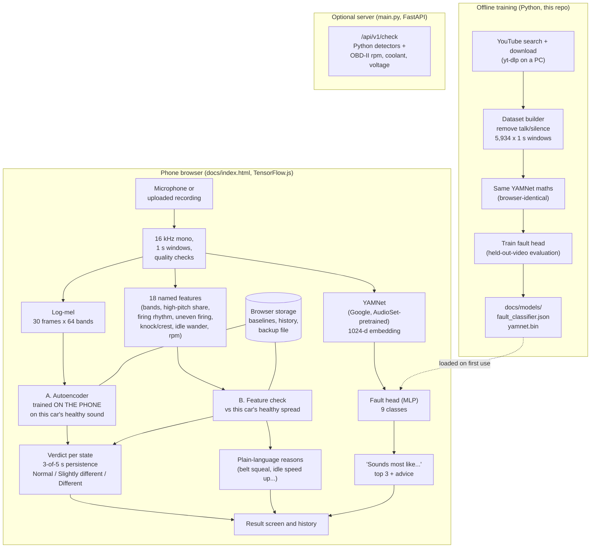

# Engine Ear: car engine sound check

*Project report, 29 October 2026. Repository: `ashandilgith/audio_deeplearning_cars`. A side project forked from Piranaware, the boat-engine diagnostic.*

Engine Ear is a phone web app. It learns what **one specific car** sounds like when healthy, then tells the owner when the engine starts to sound different, and why. A second model, trained on YouTube recordings, suggests which common fault a sound resembles. Everything runs on the phone and no audio is uploaded. A Python package mirrors the models for training, fleets and experiments.

## 1. System diagram

**Three questions, three models:**

| Question | Model | Trained on | Where it runs |
|---|---|---|---|
| Does *this* car sound like its healthy self? | A. Conditional autoencoder (log-mel, 5 stacked frames, 8-unit bottleneck, conditioned on engine state) | The owner's own healthy recordings, about 3 minutes | On the phone. It also trains on the phone, in under a minute |
| What changed? | B. Feature check: robust z-scores of 18 named features per engine state; Python adds polynomial regression on rpm, coolant and run time | The same healthy recordings | Phone (Python on the server) |
| Which common fault does it sound like? | YAMNet embedding plus a 2-layer head (256 ReLU, 9-way softmax) | 224 YouTube videos, 5,934 one-second windows | Phone (9 MB of weights, downloaded once) |

## 2. Modules

| Path | What it does |
|---|---|
| `docs/index.html` | The whole phone app in one file: recording, both anomaly detectors, on-phone training, YAMNet, fault head, history, backup, demo engine, "What's that noise?". Served by GitHub Pages from `/docs` |
| `docs/models/` | `yamnet.bin`/`.json` (YAMNet weights, float16, Apache-2.0, Google) and `fault_classifier.json` (the trained fault head) |
| `modules/anomaly/context.py` | Engine profile (cylinders, idle and max rpm; car defaults 4-cyl, 750, 6,500), engine states, operating context |
| `modules/anomaly/features.py` | Log-mel frames and named features, including the *uneven-firing* feature for any cylinder count, and rpm from the firing frequency |
| `modules/anomaly/autoencoder.py` | Detector A in Python (DCASE-style conditional autoencoder and IDNN variant, gamma-fitted thresholds, TFLite export) |
| `modules/anomaly/regression.py` | Detector B in Python (polynomial normal-behaviour model on rpm, coolant and run time, with explanations) |
| `modules/anomaly/service.py` | Per-car baselines, the 3-of-5 persistence rule, the verdict |
| `modules/anomaly/synth.py`, `distort.py` | Synthetic engines and fault-like distortions for tests |
| `modules/web_features.py` | Exact numpy copy of the app's log-mel front end |
| `modules/yamnet_embed.py` | YAMNet embeddings using exactly the app's maths |
| `modules/electrical.py`, `thermal.py` | 12 V battery and charging rules; coolant backstop (overheating, not warming up) |
| `main.py` | Optional FastAPI server: serves the app; `/api/v1/check` takes audio plus optional OBD-II rpm, coolant and voltage |
| `tools/windows/*.bat` | YouTube search and download with yt-dlp on a Windows PC |
| `tools/select_car_videos.py` | Picks videos per class from search results (duration, title rules, de-duplication, channel cap) |
| `tools/build_car_dataset.py` | Cuts 1 s windows, removes talking and silence, computes log-mel and YAMNet embeddings |
| `tools/train_yamnet_head.py` | Evaluates (3 held-out-video splits) and exports the fault head |
| `tools/train_car_classifier.py`, `exp_car_heads.py` | Baselines: a from-scratch CNN and a logistic-regression head |
| `tools/export_yamnet_web.py` | Converts the official YAMNet TFLite to browser weights (dequantised to float16) |
| `tools/train_anomaly.py` | Fits a car baseline in Python from recordings plus an optional OBD-II CSV |
| `tests/` | Python anomaly tests, browser/Python feature parity, YAMNet parity (cosine 1.0000), end-to-end browser test |

## 3. Data

**Per-car baseline (anomaly detection).** No shared data is needed. Each owner records their own car: warm idle, about 2,000 rpm, and idle with AC on. That is 3 takes of 15 s each, about 3 minutes in total. A second healthy recording on another day sets the alarm levels.

**YouTube fault dataset (classifier).** 29 + 12 yt-dlp searches gave 240 selected videos, 228 downloaded and 224 usable. Only the first 4 minutes of each video are used. One-second windows are kept when they are neither silent nor talking.

| Class | Windows | Videos |
|---|---|---|
| Healthy (normal) | 1,499 | 48 |
| Belt squeal | 421 | 23 |
| Engine knock (rod/bearing) | 973 | 23 |
| Valve / lifter tick | 455 | 23 |
| Misfire / rough idle | 503 | 24 |
| Exhaust leak | 927 | 23 |
| Start-up rattle (timing chain) | 445 | 24 |
| Whine (alternator, pump, pulley) | 524 | 24 |
| Starting problem (starter/clicking) | 187 | 12 |
| **Total** | **5,934** | **224** |

**Labels are the video's topic, not a listening check.** Fault videos also contain healthy idling, tools and narration that the filters miss. This label noise is the main limit on accuracy. The raw audio (232 MB) is kept out of git and lives on the PC in `Piranaware3\cars_download\raw_audio`.

**Synthetic data** (demo engine, distortions) is used only for tests and the in-app demo.

## 4. Performance

### Fault classifier (YouTube, held-out videos, 3 seeds, chance = 11%)

| Model | Balanced accuracy | Top-3 | Healthy vs fault | Video accuracy |
|---|---|---|---|---|
| From-scratch CNN (browser log-mel) | 15.2% | 53.6% | 59.5% | 25% |
| YAMNet + logistic regression | 22.0% | 56.8% | 71.9% | 32% |
| **YAMNet + MLP (shipped)** | **22.6%** | **59.8%** | **72.5%** | 26% |

Recall per class for the shipped head:
- Exhaust leak 37%, healthy 32%, whine 29%, belt squeal 27%
- Starting problem 23%, misfire 18%, knock 15%
- Valve tick 12%, start-up rattle 11%

**Reading:** pretrained YAMNet clearly beats training from scratch, but the classifier is still weak. That is why the app shows it only as a "sounds most like" hint (top 3) when the car's own baseline has flagged a change, and never as a diagnosis. For comparison, a 2024 industry study with 2,600+ curated recordings and 10 similar classes reached about 0.34 mAP from audio alone. Fault classification from sound is hard even with clean data.

### Anomaly detection (per-car baseline)

- **Synthetic demo engine, in the browser** (`tests/e2e_web.mjs`): healthy checks gave *Sounds normal* in 2 of 2 runs. Belt squeal, misfire and a weak cylinder each gave *Sounds different* in every run.
- **Same detectors on real engine audio with fault-like distortions** (from the Piranaware boat experiments EXP-006/007):
  - Added sounds (squeal, knock, hiss) are caught well: AUC 0.77–0.96.
  - Rhythm faults (misfire, dead cylinder, surging) are harder: AUC 0.57–0.80.
  - False alarms come mainly from changes in the recording setup, such as a different phone position or a muffled microphone. Thresholds must be set from a separate healthy recording.
- **Not yet validated on real cars with known faults.** That is the most important next step.

### Engineering checks

- Browser and Python log-mel are identical (max difference 0.00000 dB).
- Browser and Python YAMNet embeddings agree (cosine 1.0000).
- 8 Python anomaly tests pass.

## 5. Compatibility

| Vehicle / engine | Anomaly check (own baseline) | Fault hint (YouTube model) | Notes |
|---|---|---|---|
| Petrol 4-stroke, 3–8 cylinders (most cars) | ✅ Designed for this | ✅ Most training videos are this | Set cylinders and warm idle rpm when adding the car |
| Turbo petrol / diesel | ✅ | ⚠️ Turbo whistle and diesel clatter can read as whine or knock | The baseline learns the normal clatter. Hints are weaker |
| Diesel pickups/SUVs (Hilux, Montero, Ranger…) | ✅ | ⚠️ Fewer diesel examples | Common in the Philippines; worth adding diesel videos |
| Hybrids (Prius, Corolla Cross HEV…) | ⚠️ Partial | ⚠️ | The engine often switches off at idle. Hold it running (AC on) or check only while it runs |
| Cars with auto start-stop | ⚠️ | ✅ | Disable start-stop for the recording |
| Rotary (Mazda RX-7/RX-8) | ⚠️ | ❌ | The rpm/firing estimate assumes piston engines |
| Electric vehicles | ❌ | ❌ | No combustion. Motor or bearing whine would need a separate model |
| Motorcycles, scooters, tricycles | ⚠️ Untested | ❌ | Single-cylinder sound differs. The boat project's small-engine work is closer |
| Outboard boat engines | Use Piranaware | — | Same detectors, boat defaults |

**Phones and browsers**
- **Android Chrome and iOS Safari:** live microphone works when the app is served over HTTPS (GitHub Pages).
- **Inside the claude.ai artifact preview:** the microphone is blocked, so the app asks for a recording file instead.
- **Speed and storage:**
  - TensorFlow.js training takes under a minute on mid-range phones; low-end phones are slower.
  - First use of the fault hint downloads about 9 MB.
  - Baselines live in the browser's storage. A backup file is offered.
- **One baseline per phone and per phone position.** Microphones differ between phones.

## 6. Pricing estimates

*These are planning estimates, not quotes. Prices of comparable products are from public reviews (March–July 2026); check them before relying on them.*

**What comparable products charge**
- **FIXD:** OBD-II sensor about US$60, Premium about US$100/year (about US$8/month).
- **BlueDriver:** about US$90–120, one-off, no subscription.

Both read fault codes through the OBD-II port and need a plug-in sensor. Engine Ear needs no hardware and hears problems that set no code (belts, bearings, ticks, rattles). It does not read codes.

**Suggested price points (to test)**

| Tier | For | Contents | Suggested price |
|---|---|---|---|
| Free | Owners | 1 car, unlimited checks, "What's that noise?" top-1 hint | ₱0 |
| Plus | Owners and families | Up to 5 cars, full reasons and top-3 hints, history export, backup sync | ₱99/month or ₱799/year (about US$1.70 / US$14) |
| Shop | Mechanics and repair shops | Unlimited customer cars, before/after-repair reports, shareable PDF for customers | ₱499–999/month per shop |
| Fleet | Taxi, TNVS, delivery and rental fleets | Shared baselines per model, daily-check dashboard, alerts | ₱100–200 per vehicle per month, minimum 10 |

**Running costs (estimates)**

| Item | Cost |
|---|---|
| Hosting (GitHub Pages, static, all computation on the phone) | ₱0 |
| Optional API server (FastAPI on a small VPS) | about US$5–20/month |
| Sync/accounts backend (if Plus/Fleet need it; e.g. Supabase/Firebase) | US$0–25/month at the start |
| Model download | about 9 MB per user, once (free on GitHub Pages bandwidth) |

**Data costs to improve accuracy (estimates)**

| Item | Cost |
|---|---|
| Listening review of the YouTube set: about 6,000 one-second windows, roughly 10–15 hours | Founder time, or ₱3,000–6,000 for a part-time reviewer |
| Mechanic recording sessions on real faulty cars | ₱1,500–3,000 per car, plus a shop fee, likely in the same range as the boat sessions (₱2,500–5,500 per half day) |
| Validation study: 20 healthy and 20 faulty cars at partner shops | about ₱60,000–120,000 including incentives |

## 7. Way forward

1. **Clean the labels (biggest gain).** Build a listening-review page that keeps only the seconds where the fault is audible, then retrain. The Piranaware boat review page can be reused.
2. **Real recordings from shops.** Get before/after-repair recordings of cars with known faults, each with the mechanic's diagnosis. These give clean labels and validate the anomaly detector on real faults.
3. **Validate the anomaly check.** Record 20+ healthy cars on two days to measure real false-alarm rates. Record known-faulty cars to measure detection.
4. **Publish on GitHub Pages** (Settings → Pages → `main` / `/docs`) for live microphone use, and test on low-end Android phones.
5. **Optional OBD-II (ELM327 Bluetooth)** for rpm, coolant and voltage. That connects Detector B's regression model, matching the Python server. Web Bluetooth works only on Android Chrome with BLE adapters.
6. **Phone accelerometer** (phone resting on the engine cover or dashboard) for clearer firing rhythm, which helps misfire and weak-cylinder detection.
7. **Tagalog language** and a Philippine diesel-heavy class balance.
8. **Product test:** a free pilot with 2–3 repair shops before charging. Track how often a "Sounds different" result is confirmed by the mechanic.

## 8. How to run

- **Phone app:** open `docs/index.html` (GitHub Pages or any static host). Try the demo first.
- **Tests:**
  - `python -m pytest tests/test_anomaly.py -q`
  - `python tests/test_web_parity.py`
  - `python tests/test_yamnet_parity.py`
  - `node tests/e2e_web.mjs`
- **Rebuild the classifier:**
  1. Run `tools/windows/search_car_videos.bat` (PC).
  2. Run `python tools/select_car_videos.py`.
  3. Run `tools/windows/download_car_audio.bat` (PC) and copy its `raw_audio` folder to `data/raw_audio/`.
  4. Run `python tools/build_car_dataset.py`.
  5. Run `python tools/train_yamnet_head.py`.
- **Server:** `pip install -r requirements.txt` then `uvicorn main:app`.

**Sources**
- [Fine-Grained Engine Fault Sound Event Detection Using Multimodal Signals (2024)](https://arxiv.org/pdf/2403.11037)
- [OtoMechanic / OtoMobile dataset (2019)](https://arxiv.org/pdf/1911.02073)
- [YAMNet, tensorflow/models](https://github.com/tensorflow/models/tree/master/research/audioset/yamnet)
- [FIXD vs BlueDriver prices, OBD Advisor (2026)](https://obdadvisor.com/fixd-vs-bluedriver/)
- Piranaware boat experiments EXP-005 to EXP-007 (`ashandilgith/piranaware_v3`, branch `feature/anomaly-detection`)
